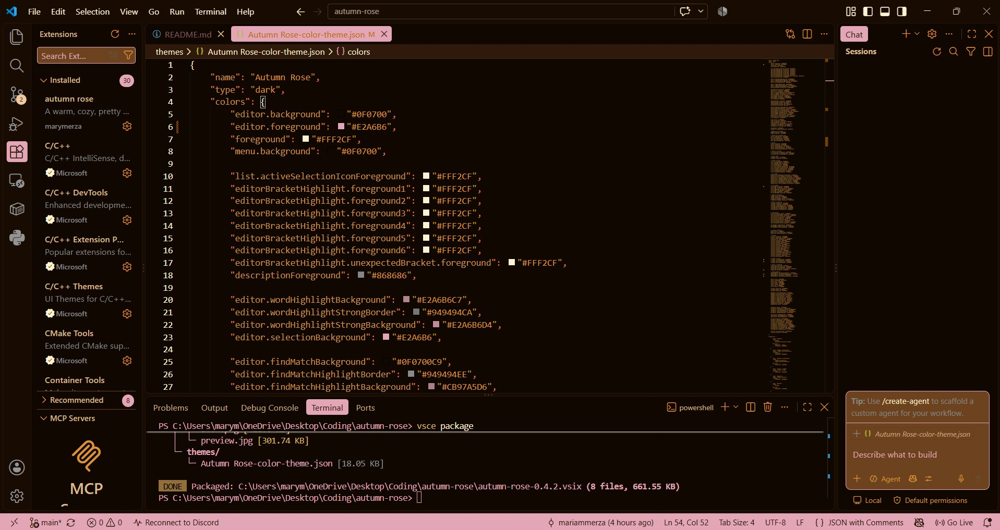

# autumn rose

────୨ৎ────  
A warm, cozy, pretty autumn inspired VS code theme reminiscent of white lace, brown leather, pumpkin spice lattes, plaid skirts, and legwarmers  
────୨ৎ────

This theme uses shades of pink, brown and beige ༄˖°.🍂.ೃ࿔*:･

### Preview

### Issues
I'll be working on/maintaining this theme in my free time so feel free to submit any issues or suggestions to my [Github](https://github.com/mary-merza/autumn-rose).

Currently working on editor coding colours (comments, strings, etc.) and sidebar icon designs.
